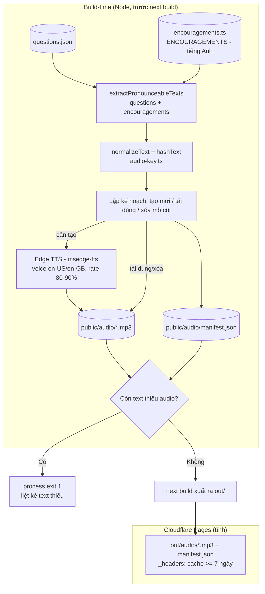

# Design Document

## Overview

Tính năng **native-pronunciation** thay giọng đọc máy móc của Web Speech API bằng tệp âm thanh neural chất lượng cao được **tạo sẵn ở bước build**. Vì toàn bộ `Pronounceable_Text` là tập hữu hạn, cố định, biết trước (trong `src/data/questions.json`), và vì ứng dụng là static export triển khai lên Cloudflare Pages (không có máy chủ runtime), giải pháp gồm ba phần:

1. **TTS_Generator** (build-time): một script Node/TypeScript (`scripts/audio/generate-audio.ts`, cùng phong cách với `scripts/content/generate.ts`) đọc toàn bộ `Pronounceable_Text`, chuẩn hóa, băm, gọi **Microsoft Edge TTS miễn phí** để sinh `.mp3` vào `public/audio/`, tạo `Audio_Manifest` (JSON), tái dùng tệp theo hash, dọn tệp mồ côi, và **làm hỏng build** nếu còn văn bản thiếu audio.
2. **Audio_Player** (runtime): module `src/lib/audio.ts` tra cứu manifest theo văn bản đã chuẩn hóa, phát `.mp3` tĩnh qua `HTMLAudioElement`, dừng audio đang phát, áp timeout 3 giây, và **suy biến về Web Speech API** hiện có (`src/lib/speech.ts`) khi thiếu/ lỗi.
3. **AudioButton** (UI): bổ sung chỉ báo "đang phát", vùng `role="status"` cho lỗi, touch target 44×44, kích hoạt bằng Enter/Space, accessible name tiếng Việt — giữ nguyên thông báo fallback hiện có.

Nguyên tắc cốt lõi để tra cứu manifest luôn khớp: **cùng một hàm chuẩn hóa `normalizeText()` và cùng một hàm băm `hashText()` được dùng ở cả generator và runtime**, tách vào một module dùng chung (`src/lib/audio-key.ts`).

### Định vị "English-native" (R8)

Ứng dụng chỉ phát ra **một loại âm thanh giọng nói duy nhất: tiếng Anh giọng bản ngữ**. Không có bất kỳ text-to-speech tiếng Việt nào ở bất kỳ vị trí nào (R8.6). Văn bản tiếng Việt trên màn hình (câu lệnh hướng dẫn, nhãn giao diện) vẫn hiển thị để học sinh đọc nhưng không được đọc thành tiếng.

Hệ quả cụ thể cho thiết kế: các lời động viên khi trả lời sai (`Encouragement_Message`) — trước đây là chuỗi tiếng Việt trong mảng `ENCOURAGEMENTS` của `src/lib/sound.ts` (ví dụ "Không sao, cố lên nhé!") — được **đổi thành câu tiếng Anh ngắn, thân thiện trẻ em** (ví dụ "Keep going!", "Almost there, try again!", "Great effort!"). Mỗi câu động viên tiếng Anh này trở thành một `Pronounceable_Text`: được **tạo sẵn thành âm thanh tiếng Anh bản ngữ ở bước build** (cùng TTS_Generator, cùng manifest) và **phát thành tiếng** khi học sinh trả lời sai, qua **cùng Audio_Player** (tra manifest → `.mp3` → Web Speech fallback). Việc phát câu động viên là **không chặn** (non-blocking): thành công hay thất bại đều không làm gián đoạn phiên học.

Để chỉ có một nguồn chân lý (single source of truth) cho danh sách câu động viên, các chuỗi này nên được tách ra một module dùng chung nhỏ **`src/lib/encouragements.ts`** để cả `src/lib/sound.ts` (runtime chọn/hiển thị) và TTS_Generator (trích xuất để tạo audio) cùng import — tránh tình trạng hai nơi định nghĩa lệch nhau khiến có câu hiển thị mà thiếu audio.

### Mapping yêu cầu → thành phần

| Yêu cầu | Thành phần chịu trách nhiệm |
|---|---|
| R1 Phát âm bản ngữ chất lượng | TTS_Generator (voice en-US/en-GB, rate 80–90%), Audio_Player |
| R2 Tạo sẵn ở build, tĩnh | TTS_Generator, `public/audio/`, Audio_Manifest |
| R3 Suy biến Web Speech | Audio_Player + `src/lib/speech.ts` |
| R4 Chỉ dùng TTS miễn phí | Edge TTS (không cần credential), đọc env nếu cần |
| R5 Tải/đệm/offline | `HTMLAudioElement`, `public/_headers`, không preload |
| R6 UX nút âm thanh tiếp cận được | AudioButton |
| R7 Đồng bộ với dataset | TTS_Generator (hash reuse, dọn mồ côi, fail-on-missing) |
| R8 Động viên tiếng Anh, không TTS tiếng Việt | `src/lib/encouragements.ts` (nguồn chung), `src/lib/sound.ts` (chọn/hiển thị), TTS_Generator (trích + tạo audio câu động viên), Audio_Player (phát non-blocking qua manifest/fallback) |

## Architecture

Hệ thống chia hai pha rõ rệt: **build-time** (sinh tài sản) và **runtime** (phát trong trình duyệt). Không có bất kỳ lời gọi mạng nào tới dịch vụ TTS lúc runtime (R4.2).



Thứ tự thực thi trong build (xem mục “Build integration”): `content:gen` (nếu chạy) → `audio:gen` → `next build`. `next build` copy `public/` vào `out/`, nên `public/audio/*.mp3` và `manifest.json` trở thành tài sản tĩnh phục vụ trực tiếp.

### Lựa chọn công cụ TTS (R4)

**Quyết định: dùng Microsoft Edge TTS miễn phí qua thư viện Node `msedge-tts`** làm mặc định.

Edge TTS truy cập dịch vụ "Read Aloud" trực tuyến của Microsoft Edge với giọng neural chất lượng cao (ví dụ `en-US-AriaNeural`, `en-US-JennyNeural`, `en-GB-SoniaNeural`), **không cần API key, không cần tài khoản Azure, không tính phí** theo ký tự/lượt gọi/thời lượng ([msedge-tts trên npm](https://www.npmjs.com/package/msedge-tts); [travisvn/edge-tts mô tả dùng được trong Node không cần Edge/Windows/API key](https://github.com/travisvn/edge-tts)). Thư viện chạy ở runtime server-side (build-time) nên phù hợp tuyệt đối với script build ([ghi chú của MsEdgeTTS rằng vẫn hoạt động trong mọi runtime server-side](https://github.com/Migushthe2nd/MsEdgeTTS)). *Nội dung tham chiếu đã được diễn đạt lại để tuân thủ yêu cầu bản quyền.*

So sánh với các phương án:

| Công cụ | Chi phí | Chất lượng | Cần key? | Phù hợp build tĩnh |
|---|---|---|---|---|
| **Edge TTS (`msedge-tts`)** ✅ | 0đ (không tính phí) | Neural, bản ngữ | Không | Rất phù hợp, chạy Node |
| Azure Cognitive Speech | Có phí sau hạn mức | Neural (cùng giọng) | Có | Vi phạm R4.1 về lâu dài; cần key |
| Google Cloud TTS | Có phí sau hạn mức | Neural | Có | Vi phạm R4.1; cần key |
| Amazon Polly | Có phí sau hạn mức | Neural | Có | Vi phạm R4.1; cần key |
| Piper (offline, local) | 0đ | Neural (hơi kém Edge) | Không | Phù hợp nhưng cần cài model/binary nặng |
| Web Speech API lúc build | 0đ | Kém, phụ thuộc máy | Không | Không chạy được headless ổn định |

Edge TTS thắng vì vừa **miễn phí tuyệt đối** (thỏa R4.1) vừa cho **giọng neural bản ngữ** (thỏa R1). Về R4.3/R4.4: Edge TTS **không yêu cầu credential**, nên tiêu chí "đọc key từ biến môi trường, không commit key" được thỏa mặc định (không có key để lộ). Thiết kế vẫn giữ một lớp đọc cấu hình tùy chọn (biến môi trường `TTS_VOICE`, `TTS_RATE`) để có thể đổi giọng mà không sửa mã; nếu về sau đổi sang nhà cung cấp cần key, lớp này sẽ đọc `TTS_API_KEY` từ env và áp dụng R4.4 (thiếu/rỗng → dừng, không tạo tệp hỏng).

Dự phòng cho Piper: nếu endpoint Edge TTS tạm thời không truy cập được trong CI, generator phải **giữ nguyên tệp hợp lệ đã có** (R1.7, R4.5) và báo lỗi — không ghi tệp rỗng/hỏng.

## Components and Interfaces

### 1. `src/lib/audio-key.ts` — Chuẩn hóa & băm dùng chung (nền tảng R7.1)

Module thuần, không phụ thuộc DOM/Node, import được từ cả generator và runtime để bảo đảm khóa tra cứu khớp tuyệt đối.

```ts
/** Chuẩn hóa: trim hai đầu + gộp mọi chuỗi khoảng trắng liên tiếp thành 1 dấu cách. */
export function normalizeText(text: string): string;

/** Băm xác định của văn bản ĐÃ chuẩn hóa -> hex. Dùng SHA-256, cắt 16 ký tự hex. */
export function hashText(normalized: string): string;

/** Đường dẫn tệp audio công khai cho một văn bản (đã chuẩn hóa) -> "/audio/<hash>.mp3". */
export function audioPathForHash(hash: string): string;
```

- `normalizeText`: `text.trim().replace(/\s+/g, " ")`. Không đổi hoa/thường (phát âm "A" khác "a" trong ngữ cảnh bảng chữ cái; giữ nguyên để an toàn, và R7.1 chỉ yêu cầu chuẩn hóa khoảng trắng).
- `hashText`: dùng `crypto` (Node) ở build-time; ở runtime KHÔNG cần băm — runtime chỉ cần `normalizeText` rồi tra `manifest.byText[normalized]`. Hash chủ yếu phục vụ generator để đặt tên tệp ổn định và so khớp tái dùng (R7.2).

### 1b. `src/lib/encouragements.ts` — Nguồn chung câu động viên tiếng Anh (R8.1, R8.5, nền tảng R8.6)

Module nhỏ, thuần dữ liệu, **không phụ thuộc DOM/Node**, là **nguồn chân lý duy nhất** cho danh sách `Encouragement_Message`. Cả `src/lib/sound.ts` (runtime chọn/hiển thị) và TTS_Generator (build-time trích để tạo audio) đều import từ đây, bảo đảm mọi câu được hiển thị đều có audio tương ứng.

```ts
/**
 * Lời động viên tiếng Anh ngắn, thân thiện trẻ em, phát khi trả lời sai (R8.1).
 * Đây là các Encouragement_Message và cũng là Pronounceable_Text: TTS_Generator
 * trích mảng này để tạo sẵn audio tiếng Anh bản ngữ (R8.5).
 * KHÔNG chứa chuỗi tiếng Việt — ứng dụng không phát TTS tiếng Việt (R8.6).
 */
export const ENCOURAGEMENTS: readonly string[] = [
  "Keep going!",
  "Almost there, try again!",
  "Great effort!",
  "You can do it!",
];

/** Chọn một câu động viên theo seed (xoay vòng, xác định với cùng seed). */
export function pickEncouragement(seed?: number): string;
```

Thay đổi liên quan ở `src/lib/sound.ts`: **gỡ mảng `ENCOURAGEMENTS` tiếng Việt cũ** và `pickEncouragement` cục bộ, chuyển sang re-export/`import` từ `src/lib/encouragements.ts`. `playCorrectSound`/`playWrongSound` (hiệu ứng tổng hợp Web Audio, không phải giọng nói) được giữ nguyên vì không phải TTS tiếng Việt.

### 2. `scripts/audio/extract.ts` — Trích xuất Pronounceable_Text (R2.1, R7.1, R8.5)

```ts
import type { Question } from "../../src/types/index.js";
import { ENCOURAGEMENTS } from "../../src/lib/encouragements.js";

/** Văn bản thô (chưa chuẩn hóa) phát được, trích từ dataset câu hỏi, theo từng dạng câu. */
export function extractQuestionTexts(questions: Question[]): string[];

/**
 * Toàn bộ Pronounceable_Text thô: văn bản câu hỏi + mọi Encouragement_Message
 * tiếng Anh (R8.5). Generator dùng hàm này làm nguồn đầu vào duy nhất.
 */
export function extractPronounceableTexts(questions: Question[]): string[];
// = [...extractQuestionTexts(questions), ...ENCOURAGEMENTS]
```

Việc trích gồm **hai nguồn**:

1. **Văn bản câu hỏi** — theo bảng quy tắc dưới đây (`types/index.ts`).
2. **Câu động viên** — toàn bộ phần tử của `ENCOURAGEMENTS` nhập từ `src/lib/encouragements.ts` (R8.5). Nhờ dùng chung một module, mọi câu động viên hiển thị lúc runtime chắc chắn nằm trong tập tạo sẵn.

Quy tắc trích văn bản câu hỏi theo `types/index.ts` (các trường tiếng Anh thực sự dùng để phát âm cho Learner):

| Dạng câu | Trường lấy làm Pronounceable_Text |
|---|---|
| `listening-choice` | `speechTextEn` (văn bản được đọc). **Không** lấy `options[].textEn` (là tiếng Việt) để tránh lộ đáp án (R3.5). |
| `choice` | `options[].textEn` (các từ tiếng Anh). `questionEn` là câu lệnh tiếng Việt-hóa, không phát. |
| `matching` | `pairs[].leftEn` (từ tiếng Anh). `rightVi` là tiếng Việt, bỏ. |
| `spell-fill` | `answerEn` (từ đầy đủ — R1.6 phát trọn vẹn một lần). |
| `unscramble` | `answerEn`. |
| `fill` | (không có văn bản tiếng Anh độc lập để phát; `acceptedAnswers` có thể bổ sung nếu sau này cần). |
| `picture-choice` | (không phát âm; dùng tranh). |

> Lưu ý: tập trường bám theo mô tả trong requirements (`questionEn`, `speechTextEn`, `textEn`, `leftEn`, `answerEn`). Generator trích **mọi** trường trong nhóm đó mà có nội dung tiếng Anh thật, cộng thêm toàn bộ `ENCOURAGEMENTS`, rồi `normalizeText` + lọc trùng. Danh sách trích chính xác là một quyết định dữ liệu và được kiểm chứng bằng Property 1 và Property 15 (mọi Pronounceable_Text — gồm cả câu động viên — phải resolvable).

### 3. `scripts/audio/generate-audio.ts` — TTS_Generator (R2, R7, R4)

Luồng chính:

1. Nạp `questions.json` **và** `ENCOURAGEMENTS` (từ `src/lib/encouragements.ts`), gọi `extractPronounceableTexts` (gộp cả hai nguồn — R8.5), `normalizeText`, bỏ trùng → tập `uniqueTexts` (Map `normalized -> hash`). Nhờ vậy mỗi câu động viên có đúng một `Pregenerated_Audio`.
2. Nạp manifest cũ nếu có (`public/audio/manifest.json`) → biết hash nào đã có tệp.
3. **Lập kế hoạch** cho mỗi `normalized`:
   - Có tệp `/audio/<hash>.mp3` và hash khớp manifest cũ → **tái dùng** (R7.2).
   - Có tệp nhưng hash khác (văn bản đổi) → **tạo lại & ghi đè** (R7.3).
   - Chưa có tệp → **tạo mới**.
4. Gọi Edge TTS cho các mục cần tạo; ghi `.mp3` ra `public/audio/`. Nếu một mục lỗi → **không ghi đè tệp cũ hợp lệ** (R1.7), gom vào danh sách lỗi.
5. **Dọn mồ côi**: xóa mọi `*.mp3` trong `public/audio/` không thuộc tập hash hiện tại (R7.4).
6. Ghi `manifest.json` mới.
7. **Cổng kiểm tra cuối**: nếu còn `normalized` nào thiếu tệp hợp lệ → in danh sách đầy đủ văn bản thiếu và `process.exit(1)` (R2.8, R7.5). Số tệp `.mp3` phải bằng số `uniqueTexts` (R7.4).

```ts
interface GenerateOptions {
  voice: string;   // mặc định "en-US-AriaNeural"; đọc từ env TTS_VOICE nếu có
  ratePercent: number; // trong [80,90]; mặc định 85 (R1.5)
  questionsPath: string;
  outDir: string;      // public/audio
  manifestPath: string;// public/audio/manifest.json
}

export async function generateAudio(opts: GenerateOptions): Promise<GenerateReport>;

interface GenerateReport {
  created: string[];   // hash đã tạo mới
  reused: string[];    // hash tái dùng
  regenerated: string[];
  removedOrphans: string[];
  missing: string[];   // văn bản chuẩn hóa thiếu audio -> gây exit(1)
  failed: { text: string; reason: string }[];
}
```

Rate cho Edge TTS truyền dạng SSML/prosody `rate="-15%"` (≈85% tốc độ gốc, trong [80,90]% → R1.5). Một từ đơn (R1.6) được đọc nguyên văn một lần vì input chỉ là chuỗi từ đó.

### 4. `src/lib/audio.ts` — Audio_Player (R2.4, R3, R5, R6.3)

Tách logic khỏi DOM-cụ-thể để test được, theo đúng phong cách `speech.ts` (inject môi trường).

```ts
import type { SpeechEnv } from "./speech";

export interface AudioManifest {
  version: number;
  byText: Record<string, string>; // normalizedText -> "/audio/<hash>.mp3"
}

export interface AudioEnv {
  manifest: AudioManifest;
  createAudio: (src: string) => HTMLAudioElement; // injectable để test
  speechEnv: SpeechEnv;
  now: () => number;
}

export type PlayOutcome =
  | "played-file"       // phát mp3 thành công
  | "fallback-spoken"   // đã suy biến sang Web Speech và đọc được
  | "unavailable";      // cả hai đều không được -> UI hiện thông báo

/** Dừng mọi audio đang phát (R6.3). */
export function stopCurrent(env: AudioEnv): void;

/**
 * Phát một văn bản: tra manifest (đã normalize) -> phát mp3 với timeout 3s;
 * miss/ lỗi/ quá hạn -> fallback speech. Trả PlayOutcome cho UI.
 */
export function playText(env: AudioEnv, rawText: string): Promise<PlayOutcome>;
```

Logic quyết định (thỏa R3.1, R3.2, R2.7):

1. `key = normalizeText(rawText)`.
2. `src = manifest.byText[key]`.
3. Nếu **không có** `src` (miss manifest) → fallback speech ngay (R3.1). Nếu speech cũng không khả dụng → `unavailable` (R3.4).
4. Nếu có `src`:
   - `stopCurrent` (R6.3), tạo `HTMLAudioElement(src)`, `play()`.
   - Đặt timeout **3 giây** (R3.2): nếu chưa phát được (chưa `playing`/`canplay`) hoặc lỗi (`onerror`) → dừng audio, fallback speech.
   - Thành công → `played-file`.
5. Fallback dùng `speak(env.speechEnv, textForSpeech)`. Với `listening-choice`, UI truyền đúng `speechTextEn` làm `rawText`, nên fallback chỉ đọc văn bản nguồn, không lộ đáp án (R3.5).

#### Phát lời động viên khi trả lời sai (R8.2, R8.3, R8.4)

Câu động viên dùng **đúng cùng đường đi** như mọi `Pronounceable_Text`: UI/logic trả lời sai lấy chuỗi tiếng Anh đang hiển thị (từ `pickEncouragement`), rồi gọi `playText(env, encouragementText)` — tra `manifest.byText` → `.mp3`; miss/lỗi/quá hạn → Web Speech fallback đọc chính câu động viên đó (R8.3, theo R3). Vì danh sách câu động viên đã được tạo sẵn (R8.5) nên trường hợp bình thường luôn trúng manifest và phát audio tiếng Anh bản ngữ (R8.2).

Điểm khác biệt quan trọng: phát câu động viên là **không chặn (non-blocking)** (R8.4). Lớp gọi KHÔNG `await` kết quả theo cách làm treo luồng xử lý câu hỏi và KHÔNG thay đổi trạng thái câu hỏi dựa trên `PlayOutcome`. Dù trả về `played-file`, `fallback-spoken` hay `unavailable`, phiên học vẫn tiếp diễn và trạng thái câu hỏi giữ nguyên. Khuyến nghị cung cấp một helper mỏng để làm rõ ý định:

```ts
/**
 * Phát lời động viên dạng "fire-and-forget": không bao giờ ném lỗi, không trả về
 * giá trị ảnh hưởng tới luồng câu hỏi. Mọi PlayOutcome đều được bỏ qua một cách
 * an toàn để không gián đoạn phiên học (R8.4).
 */
export function playEncouragement(env: AudioEnv, text: string): void;
// nội bộ: void playText(env, text).catch(() => {});
```

> R8.6 (không TTS tiếng Việt) được bảo đảm ở tầng dữ liệu: `ENCOURAGEMENTS` chỉ chứa tiếng Anh và không có nguồn văn bản tiếng Việt nào được đưa vào `playText`/`speak`. Audio_Player không phân biệt ngôn ngữ ở runtime; tính "chỉ tiếng Anh" đến từ việc mọi đầu vào phát âm đều là `Pronounceable_Text` tiếng Anh.

> R5.2 nói tới timeout tải 10 giây ở tầng player; R3.2 nói timeout 3 giây để kích hoạt fallback. Hai mốc này thống nhất: dùng **3 giây** làm ngưỡng chuyển fallback (chặt hơn, thỏa cả hai) khi phát audio; nếu không có fallback nào khả dụng thì giới hạn tải tối đa 10 giây rồi báo lỗi (R5.2).

### 5. `src/components/AudioButton.tsx` — UI (R6)

Mở rộng component hiện có, giữ nguyên interface `onUnavailable`, thông điệp fallback, và thêm trạng thái.

```ts
interface AudioButtonProps {
  text: string;            // Pronounceable_Text thô
  onUnavailable?: () => void;
  label?: string;          // mặc định "Nghe"
}
```

Thay đổi:
- Trạng thái nội bộ: `playing: boolean`, `status: "idle" | "playing" | "error" | "unavailable"`.
- Dùng `playText(audioEnv, text)` thay cho gọi trực tiếp `speak`.
- **Touch target 44×44** (R6.1): class đảm bảo `min-w-11 min-h-11` (44px) trên `Button`.
- **Kích hoạt bàn phím** (R6.2): `<button>` gốc đã xử lý Enter/Space; đảm bảo không chặn default, giữ focusable.
- **Chỉ báo "đang phát"** (R6.4): đổi icon/kiểu khi `playing` (ví dụ 🔊 → 🔈 + hiệu ứng), `aria-busy`.
- **Accessible name tiếng Việt** (R6.5): `aria-label="Nghe phát âm tiếng Anh"`.
- **Vùng `role="status"`** (R6.6, R6.7): hiển thị lỗi/không khả dụng; khi `unavailable` thì disable nút và giữ thông báo cũ *"Không phát được giọng tiếng Anh trên thiết bị này."*; khi `error` (phát hỏng sau khi bấm) thì thông báo lỗi nhưng **giữ nút kích hoạt lại được** (R6.7).

## Data Models

### Audio_Manifest (`public/audio/manifest.json`)

```jsonc
{
  "version": 1,
  "byText": {
    "cat": "/audio/3a1f9c2b4d5e6f70.mp3",
    "red": "/audio/9f8e7d6c5b4a3210.mp3",
    "Choose the word": "/audio/..."
  },
  "byHash": {
    "3a1f9c2b4d5e6f70": { "text": "cat", "voice": "en-US-AriaNeural", "rate": 85 }
  }
}
```

- `byText`: khóa = văn bản **đã chuẩn hóa**; giá trị = đường dẫn tĩnh. Runtime chỉ dùng phần này.
- `byHash`: siêu dữ liệu để generator so khớp tái dùng (R7.2) và để ghi lại voice/rate đã dùng.
- Nếu hai văn bản khác nhau chuẩn hóa về cùng chuỗi → cùng một hash → một tệp duy nhất, nhiều khóa `byText` trỏ chung (R2.6).

### Cấu trúc thư mục

```
public/audio/
  manifest.json
  3a1f9c2b4d5e6f70.mp3
  9f8e7d6c5b4a3210.mp3
  ...
```

Sau `next build`, toàn bộ nằm trong `out/audio/` và được Cloudflare phục vụ tĩnh (R2.5).

## Correctness Properties

*Một property là đặc tính hoặc hành vi phải đúng với mọi thực thi hợp lệ của hệ thống — về bản chất là một phát biểu hình thức về việc hệ thống phải làm gì. Property là cầu nối giữa đặc tả cho người đọc và bảo đảm đúng đắn kiểm chứng được bằng máy.*

Mỗi property dưới đây có một "for all" tường minh và được triển khai bằng đúng một bài property-based test (tối thiểu 100 vòng lặp). Các tiêu chí thuần UI, hiệu năng thời gian, hạ tầng và cấu hình tĩnh được kiểm bằng unit/integration/snapshot (xem Testing Strategy) chứ không bằng property.

### Property 1: Manifest completeness (mọi Pronounceable_Text đều resolvable)

*For any* `Question_Dataset` hợp lệ, với mọi `Pronounceable_Text` trích từ dataset, giá trị `normalizeText(text)` SHALL tồn tại như một khóa trong `manifest.byText` và trỏ tới một tệp `.mp3` có thật.

**Validates: Requirements 1.1, 2.1, 2.3, 7.1**

### Property 2: Chuẩn hóa xác định và lũy đẳng (idempotent & deterministic)

*For any* chuỗi `s`, `normalizeText(s)` SHALL luôn cho cùng kết quả khi gọi nhiều lần (xác định), và `normalizeText(normalizeText(s)) == normalizeText(s)` (lũy đẳng); ngoài ra kết quả KHÔNG có khoảng trắng đầu/cuối và KHÔNG chứa chuỗi khoảng trắng liên tiếp.

**Validates: Requirements 7.1**

### Property 3: Khử trùng theo chuẩn hóa (dedup)

*For any* hai `Pronounceable_Text` `a` và `b` mà `normalizeText(a) == normalizeText(b)`, generator SHALL tạo đúng một tệp `Pregenerated_Audio` duy nhất và `manifest.byText` cho cả hai SHALL trỏ tới cùng một đường dẫn.

**Validates: Requirements 2.6, 7.1**

### Property 4: Số tệp bằng số văn bản duy nhất (orphan removal)

*For any* tập tệp `.mp3` ban đầu bất kỳ trong `public/audio/` và `Question_Dataset` bất kỳ, sau khi generator chạy xong, số tệp `.mp3` còn lại SHALL bằng đúng số `normalizeText(Pronounceable_Text)` duy nhất của dataset hiện tại (không còn tệp mồ côi, không trùng lặp).

**Validates: Requirements 7.4, 2.1**

### Property 5: Tái dùng đúng theo hash (reuse iff hash khớp)

*For any* `Pronounceable_Text` mà đã tồn tại tệp tương ứng: generator SHALL tái dùng tệp (KHÔNG gọi lại TTS) khi và chỉ khi `hashText(normalizeText(text))` khớp với hash lưu trong manifest; nếu hash khác, generator SHALL tạo lại và ghi đè tệp.

**Validates: Requirements 7.2, 7.3**

### Property 6: Giữ nguyên tệp hợp lệ khi một mục lỗi

*For any* tập `Pregenerated_Audio` hợp lệ có sẵn trước đó và một mục bất kỳ bị lỗi tạo (lỗi TTS hoặc vượt hạn mức), generator SHALL giữ nguyên mọi tệp hợp lệ đã có (không xóa, không ghi đè) và gom mục lỗi vào báo cáo.

**Validates: Requirements 1.7, 4.5**

### Property 7: Cổng build liệt kê đầy đủ văn bản thiếu

*For any* `Question_Dataset` và tập tệp bất kỳ, nếu tồn tại ít nhất một `Pronounceable_Text` thiếu tệp hợp lệ, thì `report.missing` SHALL bằng đúng tập các văn bản thiếu đó và cổng build SHALL yêu cầu dừng với trạng thái thất bại (không tạo kết quả một phần).

**Validates: Requirements 2.8, 7.5**

### Property 8: Chọn nguồn theo manifest (hit → tệp, miss → fallback)

*For any* `Audio_Manifest` và văn bản `t`: nếu `normalizeText(t)` có trong `manifest.byText`, `Audio_Player` SHALL tạo `HTMLAudioElement` với `src` bằng đúng `manifest.byText[normalizeText(t)]`; nếu không có, `Audio_Player` SHALL dùng `Speech_Fallback` để đọc `t` thay vì tạo audio tệp.

**Validates: Requirements 2.4, 3.1**

### Property 9: Suy biến khi phát thất bại hoặc quá hạn

*For any* kịch bản trong {lỗi phát tệp, quá 3 giây chưa phát được}, `Audio_Player` SHALL dừng audio tệp đang xử lý rồi chuyển sang `Speech_Fallback` cho cùng văn bản.

**Validates: Requirements 3.2, 5.2**

### Property 10: Speech_Fallback khả dụng khi và chỉ khi có giọng "en"

*For any* danh sách giọng của trình duyệt, `Speech_Fallback` SHALL được coi là khả dụng khi và chỉ khi tồn tại ít nhất một giọng có `lang` bắt đầu bằng "en".

**Validates: Requirements 3.3**

### Property 11: Không lộ đáp án khi fallback câu nghe

*For any* câu `listening-choice`, văn bản được đưa cho `Audio_Player`/`Speech_Fallback` SHALL bằng đúng `speechTextEn` và SHALL KHÔNG bằng, chứa, hay để lộ bất kỳ `options[].textEn` nào.

**Validates: Requirements 3.5**

### Property 12: Không preload lúc mở trang

*For any* trang có số câu `n` bất kỳ, sau khi render lần đầu và trước mọi tương tác của người dùng, số `HTMLAudioElement` được tạo (số tệp được tải trước) SHALL bằng 0.

**Validates: Requirements 5.5**

### Property 13: Dừng âm thanh đang phát trước khi phát mới

*For any* chuỗi lần kích hoạt phát liên tiếp, trước khi bắt đầu phát một âm thanh mới, `Audio_Player` SHALL dừng (pause) âm thanh đang phát trước đó.

**Validates: Requirements 6.3**

### Property 14: Runtime chỉ dùng nguồn nội bộ (không gọi TTS ngoài)

*For any* mục trong `manifest.byText`, giá trị đường dẫn SHALL khớp mẫu `^/audio/.*\.mp3$` (tài sản tĩnh cùng origin) — bảo đảm runtime không gọi mạng tới dịch vụ TTS bên ngoài.

**Validates: Requirements 4.2**

### Property 15: Manifest completeness cho câu động viên (encouragements đều resolvable)

*For any* `Question_Dataset` hợp lệ, với mọi câu động viên `e` trong `ENCOURAGEMENTS`, sau khi generator chạy xong `normalizeText(e)` SHALL tồn tại như một khóa trong `manifest.byText`, trỏ tới đúng một tệp `.mp3` có thật. Nói cách khác, tính đầy đủ của Property 1 mở rộng để phủ toàn bộ `Encouragement_Message`, bảo đảm khi trả lời sai luôn có audio tiếng Anh bản ngữ để phát (routing hit→tệp đã được Property 8 bảo đảm).

**Validates: Requirements 8.2, 8.5**

### Property 16: Phát câu động viên là không chặn (non-blocking)

*For any* chuỗi câu động viên `e` và *for any* kết quả phát khả dĩ trong `{played-file, fallback-spoken, unavailable}` hoặc bất kỳ lỗi nào do tầng phát ném ra, lời gọi `playEncouragement(env, e)` SHALL kết thúc mà KHÔNG ném lỗi và trạng thái câu hỏi quan sát được (ảnh chụp trước/sau) SHALL giữ nguyên không đổi — việc phát hay thất bại khi phát không làm gián đoạn phiên học.

**Validates: Requirements 8.4**

### Property 17: Mọi Pronounceable_Text là tiếng Anh (không có nguồn tiếng Việt)

*For any* `Question_Dataset` hợp lệ, với mọi `Pronounceable_Text` do `extractPronounceableTexts` trả về (gồm cả văn bản câu hỏi lẫn `ENCOURAGEMENTS`), chuỗi đó SHALL không rỗng sau khi `normalizeText` và SHALL KHÔNG chứa ký tự dấu đặc trưng tiếng Việt (ví dụ các nguyên âm có dấu thanh/dấu mũ/dấu móc và `đ/Đ`), và SHALL KHÔNG được trích từ các trường chỉ-tiếng-Việt (`rightVi`, câu lệnh `questionEn` tiếng Việt-hóa) — bảo đảm ứng dụng không bao giờ đưa văn bản tiếng Việt vào đường phát âm, tức không có TTS tiếng Việt.

**Validates: Requirements 8.1, 8.6**

## Error Handling

### Build-time (TTS_Generator)

| Tình huống | Xử lý | Yêu cầu |
|---|---|---|
| Edge TTS lỗi/không truy cập được cho 1 mục | Gom vào `failed`, **không ghi đè** tệp cũ hợp lệ, không tạo tệp rỗng | R1.7, R4.5 |
| Provider (nếu đổi) cần key nhưng env rỗng | Throw sớm trước khi gọi TTS; không tạo tệp nào | R4.4 |
| Vượt hạn mức miễn phí (nếu provider có) | Dừng mục đó, log lý do, giữ tệp hợp lệ trước | R4.5 |
| Còn text thiếu tệp sau khi chạy | In danh sách đầy đủ văn bản thiếu, `process.exit(1)` | R2.8, R7.5 |
| Có tệp mồ côi | Xóa trước khi ghi manifest cuối | R7.4 |

Generator ghi manifest **sau cùng** và chỉ coi build thành công khi `missing` rỗng, nên không bao giờ sinh "kết quả build một phần" (R7.5).

### Runtime (Audio_Player + AudioButton)

| Tình huống | Xử lý | Yêu cầu |
|---|---|---|
| Miss manifest | Fallback Web Speech ngay | R3.1 |
| Manifest có path nhưng tệp lỗi tải (`onerror`) | Dừng audio, fallback | R2.7, R3.2 |
| Quá 3 giây chưa phát | Dừng audio, fallback | R3.2 |
| Quá 10 giây chưa tải xong và không có fallback | Dừng tải, báo lỗi qua `role="status"`, giữ màn hình | R5.2 |
| Cả tệp lẫn speech đều không khả dụng | `unavailable`: thông báo *"Không phát được giọng tiếng Anh trên thiết bị này."*, gọi `onUnavailable`, disable nút, giữ trạng thái câu hỏi | R3.4, R6.6 |
| Phát lỗi sau khi bấm (có thể thử lại) | `error`: báo qua `role="status"`, **giữ nút kích hoạt lại được** | R6.7, R1.3 |
| Phát câu động viên (trả lời sai) miss/lỗi/quá hạn | `playEncouragement` nuốt mọi `PlayOutcome`/lỗi, **không ném, không đổi trạng thái câu hỏi** (non-blocking); miss→fallback đọc chính câu động viên | R8.3, R8.4 |

Mọi nhánh lỗi đều **không thay đổi trạng thái câu hỏi** (R1.3, R2.7, R5.2, R8.4). Riêng với câu động viên, kể cả nhánh `unavailable` cũng KHÔNG hiển thị lỗi gây gián đoạn — thất bại được bỏ qua lặng lẽ để giữ liền mạch phiên học (R8.4).

## Testing Strategy

### Thư viện property-based

Dùng **`fast-check`** (bổ sung vào `devDependencies`) — chuẩn de facto cho PBT trên TypeScript, tích hợp sẵn với Vitest đang dùng (`vitest` đã có trong `package.json`). KHÔNG tự viết PBT từ đầu. Mỗi property test cấu hình tối thiểu **100 vòng lặp** (`fc.assert(..., { numRuns: 100 })`).

Mỗi property test gắn nhãn tham chiếu property thiết kế theo định dạng:

```ts
// Feature: native-pronunciation, Property 2: For any string s, normalizeText is deterministic & idempotent...
```

### Cách test từng tầng (dùng dependency injection sẵn có)

- **`audio-key.ts`** (thuần): test Property 2 trực tiếp với `fc.string()` và chuỗi nhiều khoảng trắng.
- **Generator** (`generate-audio.ts`): inject một `ttsClient` giả (sinh buffer giả lập, hoặc ném lỗi theo kịch bản) và một lớp filesystem ảo (hoặc thư mục tạm). Test Properties 1, 3, 4, 5, 6, 7, **15** với dataset sinh ngẫu nhiên bằng `fast-check` (mô phỏng `Question` theo union trong `types/index.ts`). Property 15 khẳng định mọi phần tử `ENCOURAGEMENTS` xuất hiện trong `manifest.byText` sau khi chạy.
- **Trích xuất** (`extract.ts`): test Property **17** với `fast-check` — mọi `Pronounceable_Text` trả về (câu hỏi + câu động viên) không rỗng sau chuẩn hóa và không chứa ký tự tiếng Việt; thêm ví dụ khẳng định `extractQuestionTexts` không bao giờ lấy `rightVi` hay câu lệnh `questionEn` tiếng Việt.
- **Audio_Player** (`audio.ts`): inject `AudioEnv` với `createAudio` giả (ghi lại `src`, mô phỏng `play`/`error`/timeout qua `now()`), và `speechEnv` giả. Test Properties 8, 9, 10, 13, 14, **16**. Property 16 khẳng định `playEncouragement` không ném với mọi `PlayOutcome`/lỗi được inject và ảnh chụp trạng thái câu hỏi trước/sau không đổi.
- **Không lộ đáp án** (Property 11): sinh ngẫu nhiên `ListeningChoiceQuestion`, khẳng định text phát == `speechTextEn` và khác mọi option.
- **No preload** (Property 12): render trang chơi với `@testing-library/react`, đếm số lần `createAudio` được gọi trước tương tác = 0.

### Unit / example tests (bổ trợ, không dùng PBT)

- `AudioButton`: Enter/Space kích hoạt (R6.2), trạng thái playing/aria-busy (R6.4), accessible name VI (R6.5), `role="status"` + disable khi unavailable (R6.6), giữ enable khi error (R6.7), thông báo fallback cố định (R3.4), touch target 44×44 (R6.1, snapshot/class assertion).
- Generator: ghi `.mp3` ra thư mục (R2.2), cấu trúc manifest (R2.3), voice mặc định `en-US`/`en-GB` (R1.4), rate trong [80,90] (R1.5), từ đơn truyền nguyên văn (R1.6), build dừng + message chứa text khi lỗi (R2.8).
- `_headers`: parse `public/_headers`, khối `/audio/*` có `max-age >= 604800` (R5.3).
- Config: không có literal key trong source; đọc `process.env` khi provider cần key (R4.3, R4.4).
- `encouragements.ts`: mảng `ENCOURAGEMENTS` không rỗng, mọi phần tử là tiếng Anh ngắn (R8.1); `sound.ts` re-export/`import` từ module chung, không còn định nghĩa chuỗi tiếng Việt cục bộ (R8.6).
- Luồng trả lời sai: khi đánh dấu một câu là sai, UI gọi `playEncouragement` với đúng câu động viên đang hiển thị (R8.2), và phiên học tiếp diễn bình thường bất kể kết quả phát (R8.4 — ví dụ bổ trợ cho Property 16).

### Integration / smoke (hiệu năng, hạ tầng, HTTP cache)

- e2e (Playwright) đo thời gian bắt đầu phát (R1.2, R5.1, R6.2) với 1–2 ví dụ.
- Smoke: sau `npm run build`, `out/audio/` tồn tại với số tệp đúng (R2.5).
- e2e/cache: lần phát thứ hai không tạo request mạng mới (R5.4) — dựa trên header đã cấu hình.

### Giải thích vì sao PBT áp dụng cho tính năng này

Phần lõi (chuẩn hóa, băm, lập kế hoạch tạo/tái dùng/xóa, chọn nguồn phát, logic fallback, trích xuất văn bản, và hành vi không-chặn của câu động viên) là **hàm thuần với input/output rõ ràng** và có **bất biến phổ quát** trên không gian input lớn (chuỗi bất kỳ, dataset bất kỳ, danh sách giọng bất kỳ, mọi `PlayOutcome`). Đây đúng là nơi PBT phát huy — gồm cả các property mới cho câu động viên (completeness 15, non-blocking 16, bất biến chỉ-tiếng-Anh 17). Ngược lại, UI rendering, thời gian phản hồi, HTTP cache và việc dựng hạ tầng tĩnh **không** hợp PBT và được phủ bằng unit/snapshot/integration như trên.

## Build Integration

Thêm script và móc vào trước `next build` trong `package.json`:

```jsonc
{
  "scripts": {
    "audio:gen": "tsx scripts/audio/generate-audio.ts",
    "prebuild": "npm run audio:gen",
    "build": "next build"
  }
}
```

- `prebuild` được npm tự chạy **trước** `build`, nên `audio:gen` luôn chạy trước `next build` mà không cần đổi lệnh deploy hiện có (`scripts/deploy.sh` gọi `npm run build`).
- `audio:gen` dùng `tsx` (đã có trong `devDependencies`) để chạy TypeScript trực tiếp, cùng cách `scripts/content/generate.ts` được mô tả chạy bằng `tsx`.
- Nếu dataset được sinh lại, chạy `tsx scripts/content/generate.ts` trước `audio:gen` (có thể gộp vào một script `content:build` nếu muốn), để audio luôn khớp `questions.json` mới nhất (R7).
- Vì `audio:gen` gọi `process.exit(1)` khi thiếu audio (R7.5), `prebuild` thất bại sẽ chặn `next build`, bảo đảm không deploy bản thiếu tiếng.

### Cấu hình cache Cloudflare (`public/_headers`)

Thêm khối cho `/audio/*` với cache dài hạn ≥ 7 ngày (R5.3). Tệp đặt tên theo hash nội dung nên an toàn để cache lâu (đổi nội dung → đổi hash → đổi URL):

```
# Pregenerated audio: hash-named, an toàn cache dài hạn (>= 7 ngày).
/audio/*
  Cache-Control: public, max-age=604800, immutable
```

`manifest.json` nên cache ngắn hơn (hoặc `no-cache`/revalidate) để client luôn lấy ánh xạ mới sau mỗi lần deploy; vì manifest được bundle vào JS build hoặc fetch cùng origin, thực tế có thể import trực tiếp lúc build để tránh một vòng mạng runtime.
